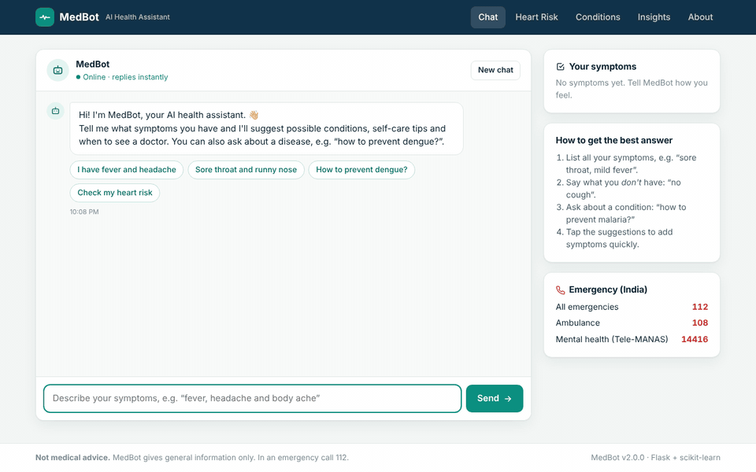
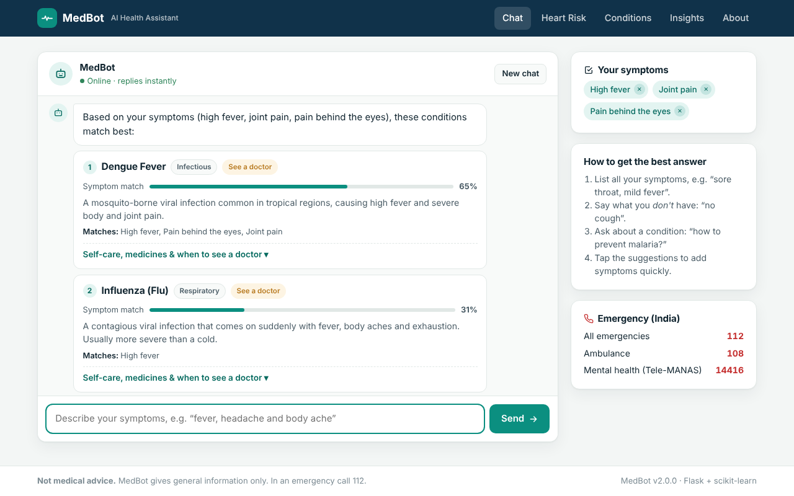
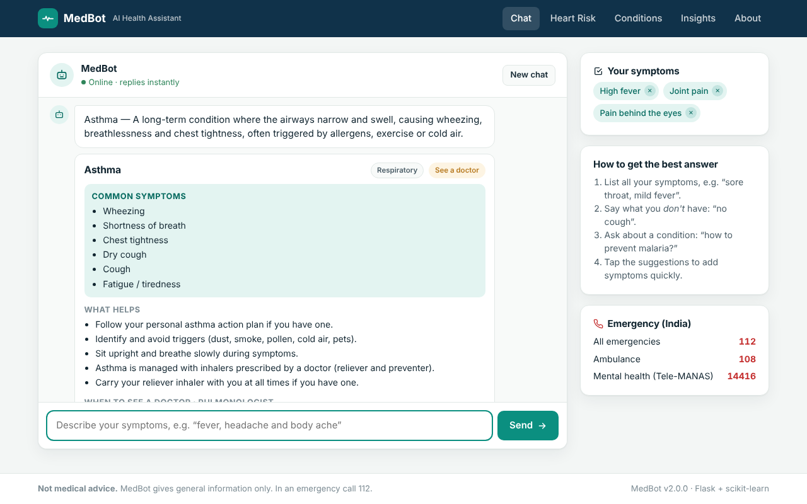
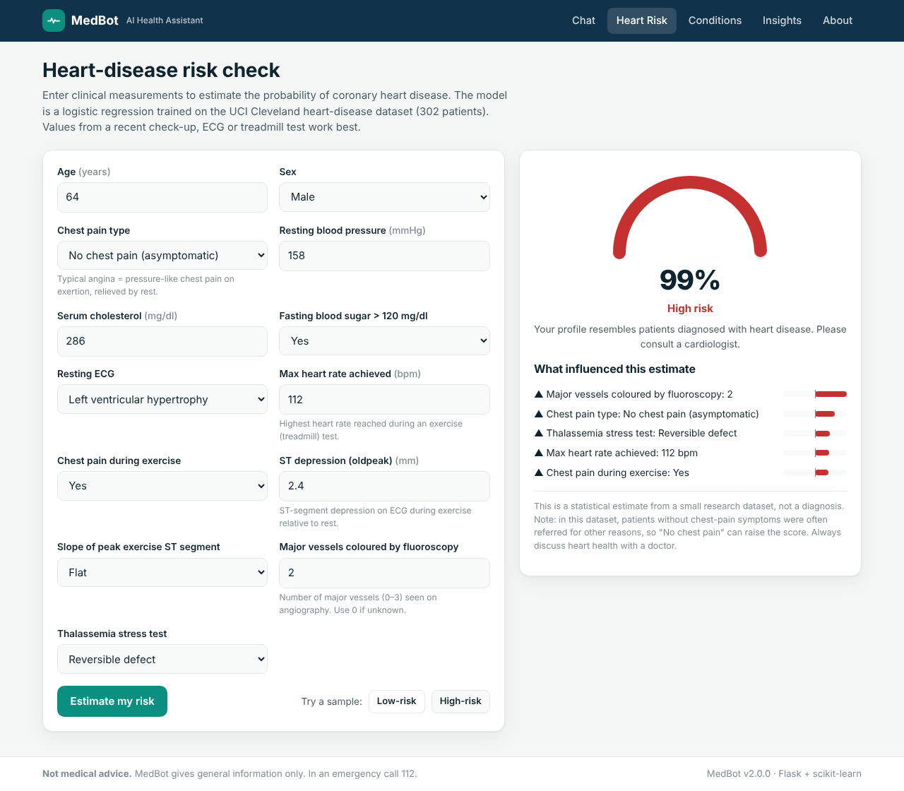
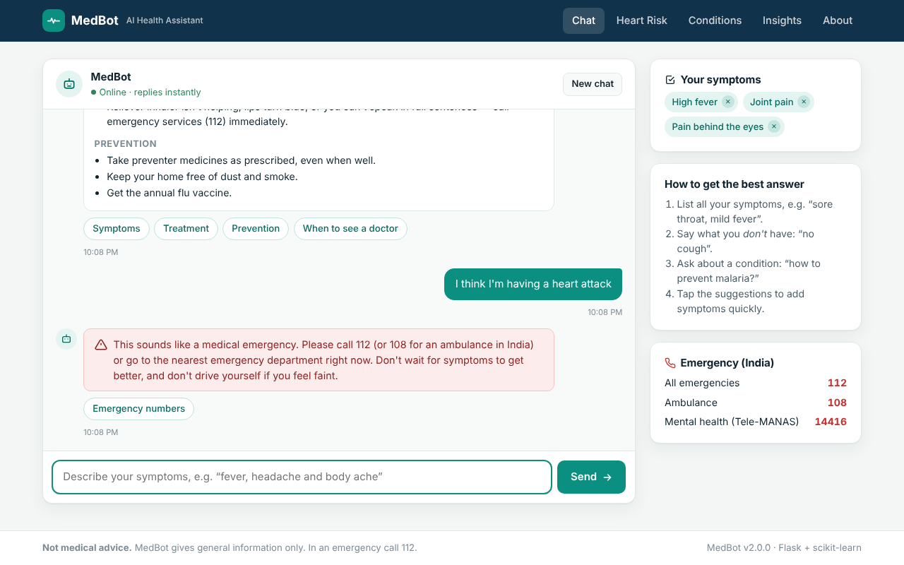
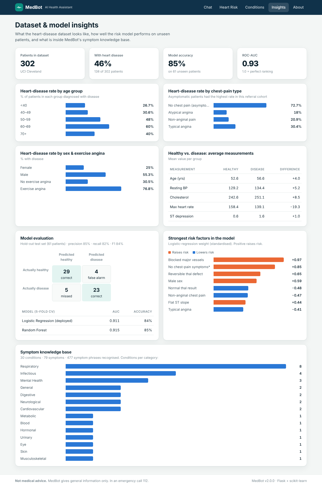
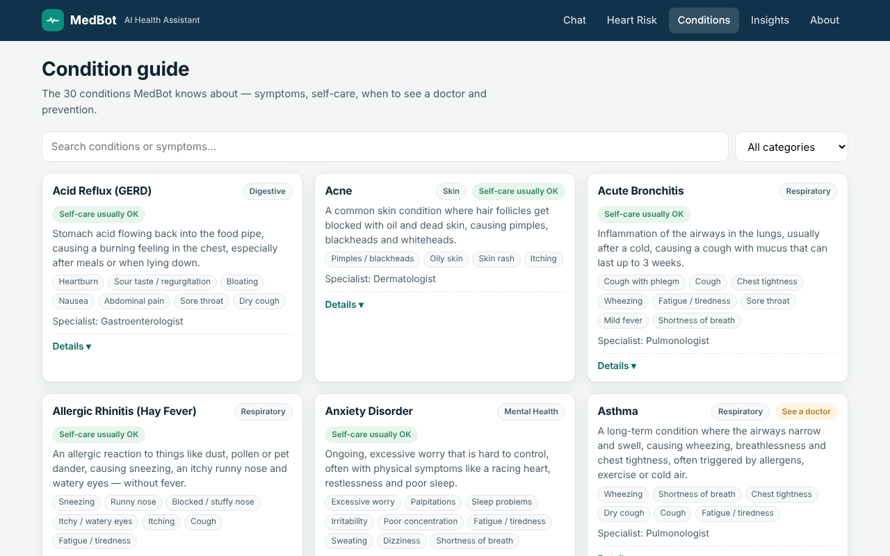
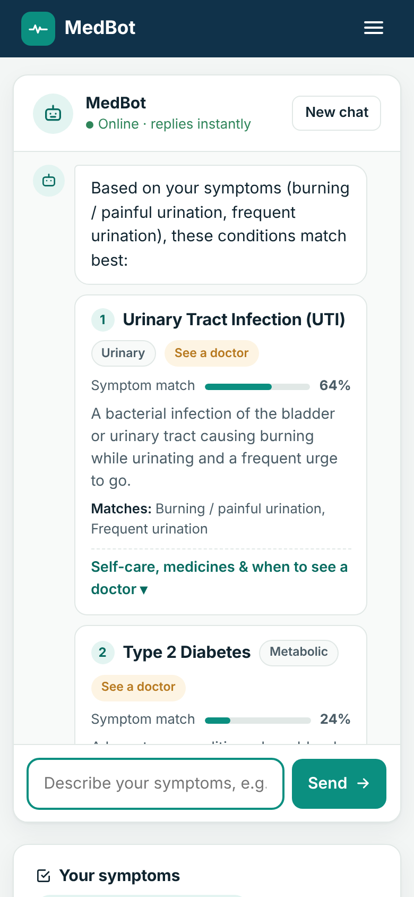
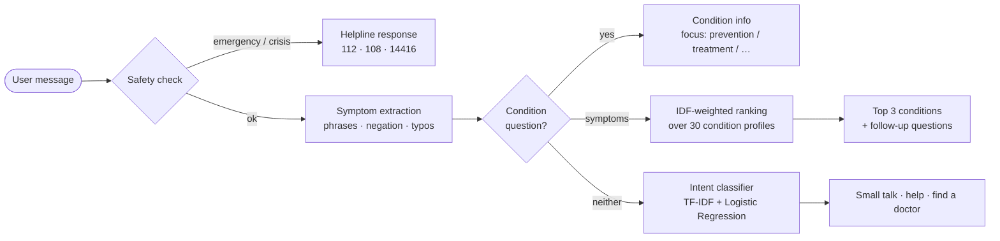

<div align="center">

# 🩺 MedBot: AI Health-Care Chatbot

**A web app that checks your symptoms, explains common conditions and estimates heart-disease risk with machine learning.**




</div>

> ⚠️ **Not medical advice.** MedBot gives general health information for learning purposes. It is not a doctor and does not diagnose. In an emergency call **112** (India) or your local emergency number.

---

## ✨ Features

| | Feature | What it does |
|---|---|---|
| 💬 | **Symptom checker chat** | Describe how you feel in plain English (*"high fever, joint pain and pain behind my eyes"*). MedBot pulls out the symptoms, ranks the 3 best-matching conditions, and suggests follow-up symptoms to narrow the result. |
| 🧠 | **Understands real language** | 470+ symptom phrases, negation (*"no fever"*), typo tolerance (*"diarhea"*) and symptoms that build up over several messages. |
| 📚 | **Condition guide** | 30 common conditions (cold, flu, dengue, malaria, typhoid, diabetes, asthma, UTI, migraine, depression…), each with self-care, safe medicine guidance, red flags, prevention and which specialist to see. |
| ❤️ | **Heart-disease risk predictor** | A logistic-regression model trained on the UCI Cleveland dataset (**85% accuracy, 0.93 ROC-AUC** on held-out patients). It explains which factors raised or lowered your score. |
| 📊 | **Insights dashboard** | Dataset statistics, model evaluation (confusion matrix, cross-validated model comparison) and the strongest risk factors. |
| 🚨 | **Safety first** | Emergency and crisis messages are detected *before* anything else and answered with helpline numbers (112, 108, Tele-MANAS 14416). Dangerous symptom combinations (e.g. chest pain + sweating) raise an alert. |
| 📱 | **Responsive UI** | Works on desktop and mobile, with no front-end framework and no external CDN. |

## 📸 Demo

| Symptom checker | Condition info |
|---|---|
|  |  |

| Heart-disease risk | Emergency detection |
|---|---|
|  |  |

| Insights dashboard | Condition guide | Mobile |
|---|---|---|
|  |  |  |

### Try these messages

```text
I have a high fever, joint pain and pain behind my eyes
sore throat and runny nose but no fever
burning while urinating and peeing a lot
how to prevent malaria?
what medicine for acidity
which doctor should I see for migraine
check my heart risk
start over
```

## 🚀 Quick start

```bash
git clone https://github.com/nvaltryek-001/Health-Care-Chatbot-AI.git
cd Health-Care-Chatbot-AI

python -m venv .venv
source .venv/bin/activate          # Windows: .venv\Scripts\activate
pip install -r requirements.txt

python scripts/train.py            # optional: models also train automatically on first run
python run.py                      # open http://127.0.0.1:5000
```

### With Docker

```bash
docker build -t medbot .
docker run -p 8000:8000 medbot     # open http://localhost:8000
```

### Run the tests

```bash
pip install -r requirements-dev.txt
pytest -q
```

### Deploy

The repo includes a `Procfile` and a `Dockerfile`, so it runs as-is on Render, Railway, Fly.io or Heroku-style platforms. Use the start command `gunicorn 'app:create_app()' --bind 0.0.0.0:$PORT`.

## 🧩 How it works



1. **Safety check** (`app/safety.py`) looks for emergency and self-harm phrases first. Questions like *"how to prevent a heart attack"* are recognised as informational and are not treated as emergencies.
2. **Symptom extraction** (`app/symptom_checker.py`) matches the longest phrase first (so "high fever" wins over "fever"), handles negation inside a 4-word window that stops at "but", and fuzzy-matches single-word typos.
3. **Condition ranking** scores each condition with an F1-style overlap between *how much of the condition's profile you have* and *how much of your symptoms it explains*. Rare, specific symptoms (pain behind the eyes) carry more weight than generic ones (fatigue), using IDF. The client keeps the symptom list and sends it back each turn, so the server stays stateless.
4. **Intent model** (`app/intent_model.py`): word and character n-gram TF-IDF with logistic regression handles greetings, help, *find a doctor* and similar messages. Low-confidence messages fall back to a helpful prompt.
5. **Heart model** (`app/heart_model.py`): standardised numeric features plus one-hot categoricals feed a logistic regression. Each prediction is explained by its per-feature contribution to the log-odds.

### Model performance (heart disease)

| Model | 5-fold CV ROC-AUC | 5-fold CV accuracy |
|---|---|---|
| **Logistic Regression** (deployed) | 0.911 | 84.1% |
| Random Forest | 0.915 | 85.1% |

On a stratified 20% hold-out set the deployed model scores **85.2% accuracy, 0.929 ROC-AUC, 85% precision and 82% recall**. Logistic regression was chosen because it matches the forest within noise on 302 patients and its coefficients give honest per-feature explanations.

> **Data note:** `heart-disease.csv` is the popular Kaggle re-upload of the UCI Cleveland data. In that version the label is inverted (`target = 1` is the *healthy* group: younger, higher max heart rate, less exercise angina), and several categorical columns are re-coded. MedBot models `has_disease = 1 − target`. It decodes the categories by matching their frequencies to the original UCI documentation, and a unit test checks the label direction. See the docstring in `app/heart_model.py` for details.

## 📁 Project structure

```text
├── app/
│   ├── __init__.py          # Flask app factory
│   ├── routes.py            # pages + JSON API
│   ├── chatbot.py           # conversation engine (routing, replies)
│   ├── symptom_checker.py   # symptom extraction + condition ranking
│   ├── intent_model.py      # TF-IDF + logistic-regression intent classifier
│   ├── heart_model.py       # heart-disease model, explanations, dataset insights
│   ├── safety.py            # emergency / crisis detection
│   ├── knowledge.py         # knowledge-base loader
│   ├── services.py          # model registry (load or train on first use)
│   ├── templates/           # Jinja2 pages
│   └── static/              # CSS + vanilla JS
├── data/
│   ├── conditions.json      # 30 conditions: symptoms, care, red flags, prevention
│   ├── symptoms.json        # 79 symptoms, 470+ phrases
│   ├── intents.json         # chatbot intents
│   └── heart-disease.csv    # UCI Cleveland heart-disease dataset
├── notebooks/Data_Analysis.ipynb
├── scripts/train.py         # trains models -> models/
├── tests/                   # pytest suite (39 tests)
├── Dockerfile · Procfile · requirements.txt
└── .github/workflows/ci.yml
```

## 🔌 API

| Method | Endpoint | Body / response |
|---|---|---|
| `POST` | `/api/chat` | `{"message": "fever and cough", "symptoms": ["headache"]}` → reply, updated symptoms, ranked conditions, suggestions, alerts |
| `POST` | `/api/chat` | `{"action": "rerank", "symptoms": [...]}` re-ranks after a symptom is removed |
| `POST` | `/api/heart/predict` | `{"age": 54, "sex": 1, "cp": 0, ...}` → `{"percent": 72, "level": "High", "factors": [...]}` |
| `GET` | `/api/insights` | dataset statistics, model metrics, knowledge-base summary |
| `GET` | `/api/conditions` · `/api/symptoms` · `/api/heart/features` | knowledge base and form metadata |
| `GET` | `/api/health` | `{"status": "ok"}` |

```bash
curl -s localhost:5000/api/chat -H 'Content-Type: application/json' \
  -d '{"message":"I have diarrhea and vomiting","symptoms":[]}'
```

## ➕ Extending MedBot

* **Add a condition:** append an entry to `data/conditions.json` that uses symptom ids from `data/symptoms.json`. The tests check that every referenced symptom exists.
* **Teach a new symptom phrase:** add it to the `phrases` list in `data/symptoms.json`.
* **Add small talk:** add an intent to `data/intents.json` and run `python scripts/train.py`.

## ⚖️ Limitations

* MedBot covers common conditions only and cannot examine you or order tests. Treat its suggestions as a starting point for a conversation with a doctor.
* The heart model was trained on 302 patients from a single hospital (1988). It shows how ML works on clinical data and is not a validated clinical tool.
* Medicine guidance is limited to general over-the-counter advice ("follow the label"). Prescription treatment is always referred to a doctor.

## 🙏 Credits

* Rebuilt from the original *Health-Care-Chatbot* by **Amber Kakkar** (MIT License). The original Tkinter + Keras version is preserved in this repository's git history.
* Heart-disease data: Detrano et al. (1989), UCI Machine Learning Repository: *Heart Disease (Cleveland)*.

## 📄 License

[MIT](LICENSE)
